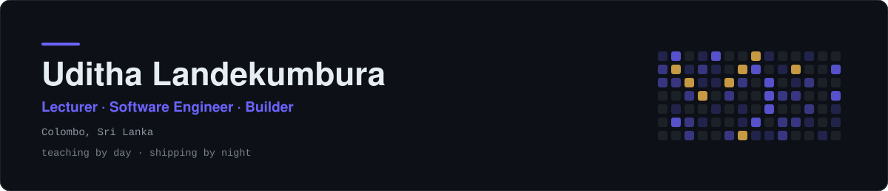
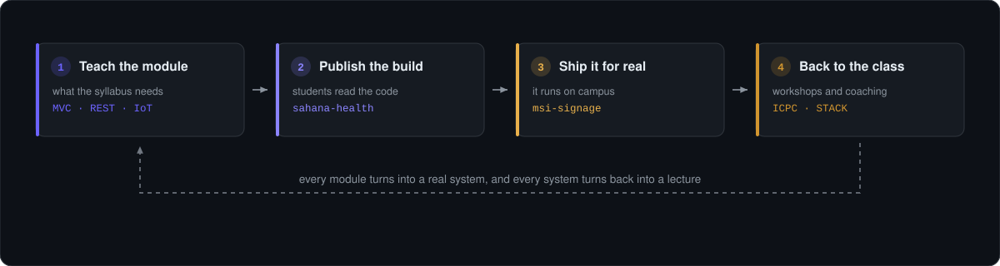

<div align="center">

<picture>
  <source media="(prefers-color-scheme: dark)" srcset="https://raw.githubusercontent.com/uditha1994/uditha1994/main/assets/banner-dark.svg" />
  <source media="(prefers-color-scheme: light)" srcset="https://raw.githubusercontent.com/uditha1994/uditha1994/main/assets/banner-light.svg" />
  
</picture>

<br/>

<a href="https://git.io/typing-svg">
  
</a>

<br/><br/>


<a href="https://github.com/uditha1994?tab=followers"></a>
<a href="https://www.linkedin.com/in/uditha94/"></a>

<br/>

*උදේ උගන්වනවා, රෑට හදනවා.*

</div>

---

### Start here

| If you are a | Go to |
|---|---|
| **Student of mine** | [Built for the classroom](#built-for-the-classroom), the code behind the lectures |
| **Recruiter or client** | [Selected work](#selected-work) |
| **Fellow builder** | [Get in touch](#get-in-touch) |

---

## Who I am

I sit on both sides of the desk. By day I am a **Lecturer and Program Manager** at the Management and Science Institute in Sri Lanka, teaching Computer Science diploma and degree students. The rest of the time I am a **software engineer** shipping real systems.

```yaml
name:      Uditha Landekumbura
role:      Lecturer & Program Manager, MSI Sri Lanka
also:      Software Engineer, full stack
teaches:   Computer Science · Research Methodology · NLP · E-Commerce
builds:    Spring Boot · React · Angular · Node.js · Laravel · PHP · IoT
coaches:   ICPC Sri Lanka team · STACK, the campus ICT club
based_in:  Colombo, Sri Lanka
```

---

## How the work loops

Almost nothing here is a portfolio piece built to be looked at. The teaching and the engineering feed each other, and this is the shape that takes.

<div align="center">

<picture>
  <source media="(prefers-color-scheme: dark)" srcset="https://raw.githubusercontent.com/uditha1994/uditha1994/main/assets/loop-dark.svg" />
  <source media="(prefers-color-scheme: light)" srcset="https://raw.githubusercontent.com/uditha1994/uditha1994/main/assets/loop-light.svg" />
  
</picture>

</div>

A module on MVC becomes [sahana-health](https://github.com/uditha1994/sahana-health), written live in a 90 minute class. A timetable problem on campus becomes [msi-signage](https://github.com/uditha1994/msi-signage), which now runs on the Smart TVs. A browser game becomes the material for a two hour workshop. Then all of it goes back into next year's syllabus.

---

## What I am working on right now

| | |
|---|---|
| 📚 **Studying** | Google Cloud Generative AI Leader certification, roadmap published below |
| 🏆 **Coaching** | A student team for the ICPC Sri Lanka regionals |
| 🎓 **Running** | STACK, the student led ICT club at the MSI Faculty of Computing |
| 🎮 **Building** | Browser games with a Sri Lankan setting, used as workshop material |
| 🤖 **Teaching** | Robotics and IoT workshops for school students, and AI tool training for teachers |

---

## Selected work

| Project | What it is | Stack |
|---|---|---|
| [**Ceyrom**](https://github.com/uditha1994/ceyrom) | Sri Lankan carrom in the browser. Play the computer, play on one screen, or play online. Trilingual: English, Sinhala, Tamil | TypeScript, Vite, Node |
| [**MSI Digital Signage**](https://github.com/uditha1994/msi-signage) | Campus signage running on Smart TVs: daily timetable, lecturer photos, Excel import, meeting mode. In use on campus | Python, Flask, Firebase |
| [**Institute Management**](https://github.com/uditha1994/institute-management-laravel) | Administration system for an institute: subjects, exams and result processing | Laravel, PHP, MySQL |
| [**BiteDash**](https://github.com/uditha1994/bitedash_frontend) | Food ordering platform, built as a separate [API backend](https://github.com/uditha1994/bitedash_backend) and Angular client | Angular 17, Node, TypeScript |
| [**රාවණ යුද්ධය**](https://github.com/uditha1994/ravana-yuddaya) | Top down shooter across five historic Sri Lankan locations, drawn from local mythology | Vanilla JS, Canvas |
| [**Gen AI Leader Roadmap**](https://github.com/uditha1994/google-gen-ai-leader-roadmap) | A seven stage, self tracked study roadmap for the Google Cloud certification. The repo is the progress tracker | Markdown, GitHub Actions |

---

## Built for the classroom

These are the reference implementations I write for the modules I teach, kept public so my students, and anyone else, can read the code behind the lecture.

| Topic I teach | Repository |
|---|---|
| MVC and layered architecture | [sahana-health](https://github.com/uditha1994/sahana-health) · [CRUD_with_Layered_Architecrure](https://github.com/uditha1994/CRUD_with_Layered_Architecrure) |
| Design patterns and SOLID | [coffee_shop_design_patterns](https://github.com/uditha1994/coffee_shop_design_patterns) · [SOLID_Practice](https://github.com/uditha1994/SOLID_Practice) |
| REST API design | [mobile_pos_api](https://github.com/uditha1994/mobile_pos_api) · [bitedash_backend](https://github.com/uditha1994/bitedash_backend) |
| Spring Boot and Java | [spring-crudoperation](https://github.com/uditha1994/spring-crudoperation) · [SpringDemo](https://github.com/uditha1994/SpringDemo) |
| JavaScript fundamentals | [quizapp-js](https://github.com/uditha1994/quizapp-js) · [weather-application-js](https://github.com/uditha1994/weather-application-js) |
| React basics | [registration-with-react](https://github.com/uditha1994/registration-with-react) · [simple-blog-react](https://github.com/uditha1994/simple-blog-react) |
| E-commerce development | [Ecomm_2024June](https://github.com/uditha1994/Ecomm_2024June) · [ceyloncart-front-webapp](https://github.com/uditha1994/ceyloncart-front-webapp) |
| IoT with ESP8266 | [smart_room_control](https://github.com/uditha1994/smart_room_control) · [room-visitor-monitor](https://github.com/uditha1994/room-visitor-monitor) |

---

## Tech I actually ship with

<div align="center">

**Languages**


**Frameworks**


**Data, infra and hardware**


</div>

---

## A year of commits

<div align="center">

<picture>
  <source media="(prefers-color-scheme: dark)" srcset="https://raw.githubusercontent.com/uditha1994/uditha1994/output/github-snake-dark.svg" />
  <source media="(prefers-color-scheme: light)" srcset="https://raw.githubusercontent.com/uditha1994/uditha1994/output/github-snake.svg" />
  
</picture>

<br/>


</div>

---

## Get in touch

I am interested in collaborations on education technology, student projects worth taking further, and freelance work that is a genuine fit.

<div align="center">

<a href="mailto:uditha@programmer.net"></a>
<a href="https://www.linkedin.com/in/uditha94/"></a>
<a href="https://www.buymeacoffee.com/tharukau0"></a>

<br/><br/>

> The best way to learn a thing properly is to have to explain it to thirty people on a Monday morning.

</div>
